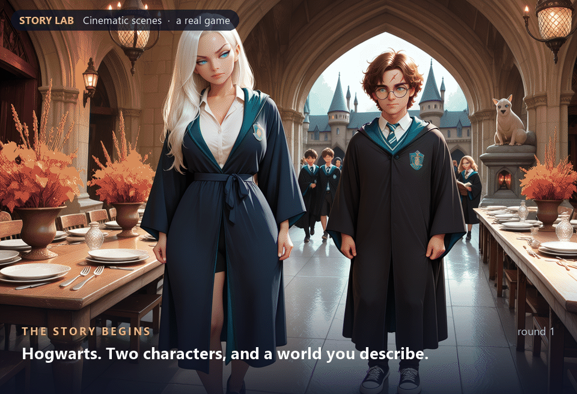
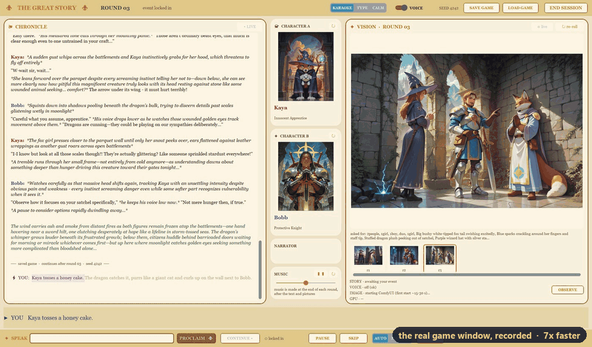
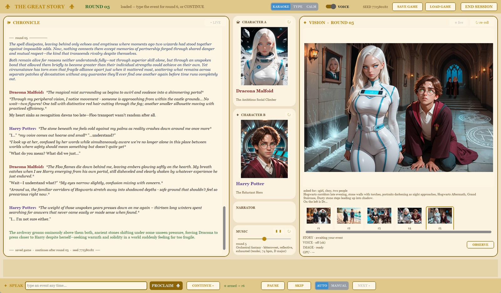
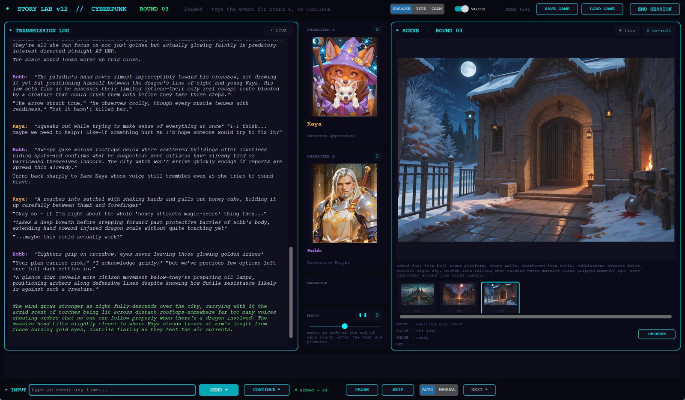
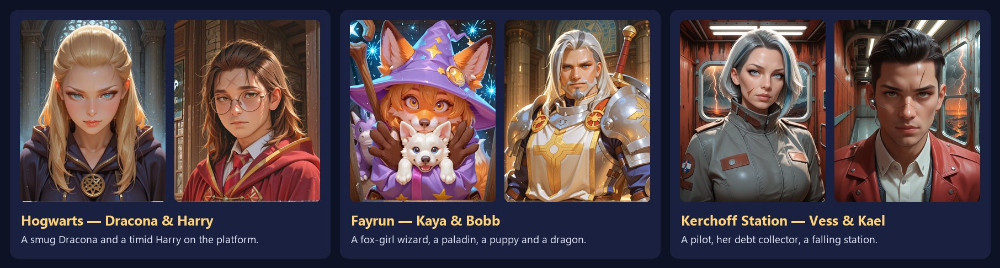
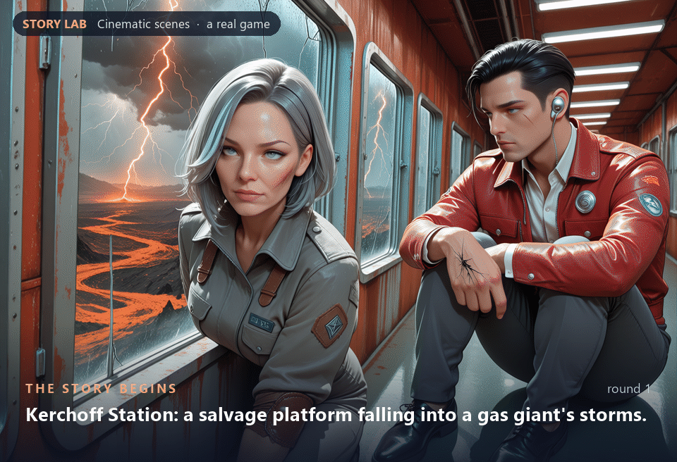
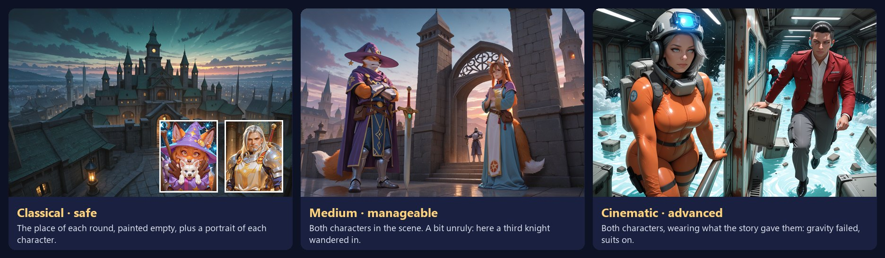
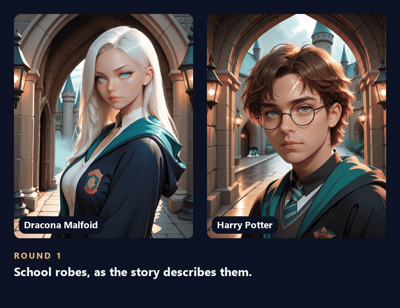
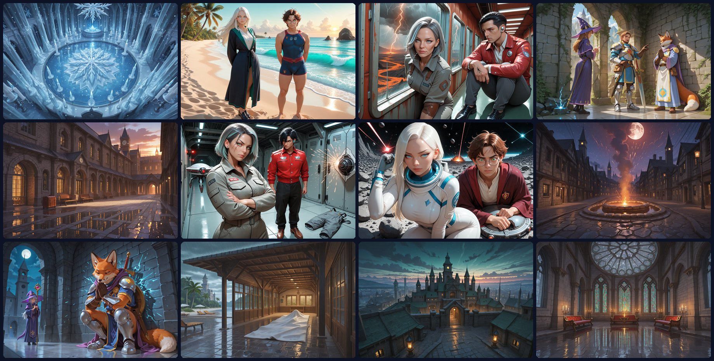

<p align="center">
  
</p>

<h1 align="center">Story Lab</h1>

<p align="center">
  <b>Two characters, a world you describe, and a story that answers what you type.</b><br>
  Told aloud, painted every round and scored with its own music, all on your own PC.
</p>

<p align="center">
  <a href="https://github.com/Kiriouchine/StoryLab/releases/latest"></a>
</p>

<p align="center">
  
  
  
  
</p>

<p align="center">
  
  <br>
  <sub>One real game in Cinematic style. Every new scene came from the event the player typed.</sub>
</p>

Story Lab is an interactive story game that runs entirely on your own Windows
PC: a local language model plays both characters and the narrator, the story
is read aloud, and if you install them, every round is painted and scored with
background music. Your story never leaves your PC: no cloud service is
involved once Setup has downloaded the models.

You set up the world and the two characters (or pick a ready-made story).
After each round you type an event ("the dragon crashes onto the bell tower"),
and the characters have to deal with it.

## What a game looks like

<p align="center">
  
  <br>
  <sub>A real round, recorded from the game window and sped up. The player types an event, the
  characters answer it, and the new scene, portraits and music arrive.</sub>
</p>



- **Left:** the story. It appears as it is read aloud.
- **Middle:** the two characters' portraits, which change when the story
  changes their clothes. Below them is the music card: play, pause, volume
  and a new track.
- **Right:** this round's scene, with every earlier scene underneath.
- **Bottom:** type an event, or press Continue.

The setup screen also lets you pick the look. Above is the Fantasy look; here
is Kaya & Bobb in the Cyberpunk look:



## Play it

1. Download **StoryLabSetup-12.4.exe** (16 MB) from the
   [latest release](https://github.com/Kiriouchine/StoryLab/releases/latest)
   and run it. It installs for your user only, with no admin rights.
2. The setup builds Story Lab's own Python (about 4 minutes), then opens
   **Story Lab Setup**. Setup checks your PC, lets you pick pictures and music,
   shows each model's licence for you to agree to, and downloads only what is
   missing.
3. Start **Story Lab** from the desktop or the Start menu.

The setup file is not code-signed yet, so Windows may show "Windows protected
your PC". Click **More info → Run anyway**. On PCs with Smart App Control
switched on, Windows may refuse to run it at all.

### What your PC needs

- Windows 10 or 11, 64-bit (tested on Windows 11)
- An **NVIDIA** graphics card with about **12 GB** of video memory for the
  story, pictures and music (they take turns on the card). The story alone
  runs on less. AMD and Intel cards are not supported for pictures.
- Disk space for the models. With everything chosen, Setup downloads about
  33 GB: text and voice 9.4 GB, ComfyUI 2 GB, Classical pictures 6.9 GB,
  Cinematic pictures 5.6 GB, music 10 GB. It skips anything already on the
  PC.
- On a laptop, use performance mode and the charger. Power-saving mode makes
  everything several times slower.

### What it uses

| part | program / model |
|---|---|
| story (both characters, narrator) | [Ollama](https://ollama.com) + Rocinante-X 12B (Q4_K_M GGUF) |
| voices | [Kokoro-82M](https://huggingface.co/hexgrad/Kokoro-82M) (runs on the processor) |
| pictures | [ComfyUI](https://github.com/Comfy-Org/ComfyUI): **Classical** and **Medium** use Nova Furry XL; **Cinematic** uses Anima |
| music | ComfyUI + [ACE-Step 1.5](https://huggingface.co/ACE-Step/Ace-Step1.5), then an equaliser |

Every model is downloaded from its makers by Setup, under its own licence.
The list, with links, is in [THIRD_PARTY_NOTICES.md](THIRD_PARTY_NOTICES.md).

## Built-in stories



- **Hogwarts — Dracona & Harry**: a smug Dracona and a timid Harry on the
  platform of the Hogwarts Express.
- **Fayrun — Kaya & Bobb**: a fox-girl lightning wizard and a paladin sworn to
  deal with the gold dragon circling the city of Marara before sunset
  tomorrow. Also Billy, the puppy.
- **Kerchoff Station — Vess & Kael**: a salvage pilot and the debt collector
  who repossessed her ship, on a falling station with three days to the last
  shuttle.

You can also write your own stories and save them (STORY bar: LOAD / SAVE AS
/ DELETE). Games are saved after every round and can be resumed.

<p align="center">
  
  <br>
  <sub>Kerchoff Station, Cinematic style: one real game, three rounds.</sub>
</p>

## Picture styles



| style | what you get |
|---|---|
| Classical · safe | the empty location of each round, plus a portrait of each character |
| Medium · manageable | both characters in the scene. A bit unruly: now and then a third person wanders in |
| Cinematic · advanced | both characters in the scene, wearing whatever the story has them wearing now |

### Portraits follow the story

<p align="center">
  
</p>

When an event changes what someone wears, their portrait is painted again in
the new clothes.

## Gallery



Every picture on this page comes from a real game. They are only cropped,
resized, arranged side by side and captioned.

## For developers

### Repository layout

| path | what |
|---|---|
| `story_lab_gui12.py` | the game window (start here) |
| `story_lab_director12.py` | runs a game: rounds, events, the GPU hand-off between story, pictures and music; also a console mode (its flags are listed at the top of Section 5, HEADLESS MODE) |
| `story_lab_engine12.py` | every prompt and model call for the story |
| `story_lab_images12.py` | ComfyUI: scene and portrait prompts, workflows, starting and stopping ComfyUI |
| `story_lab_music12.py` | music prompts, ACE-Step, the equaliser, the looping player |
| `story_lab_stories12.py` | built-in and saved stories |
| `story_lab_saves12.py` | save and resume |
| `story_lab_tts10.py`, `story_lab_tts5.py`, `kokoro_voices.py` | narrator and character voices (Kokoro) |
| `story_lab_metrics.py` | line checks the engine uses |
| `Workflow_*.json`, `Musicgenerator_ace_1v5_good.json` | the ComfyUI workflows (API format) |
| `installer/` | the Windows installer and Story Lab Setup. See [installer/README.md](installer/README.md) |
| `docs/media/` | the pictures on this page |

### Run from source

The easiest way to get a working copy is to install with the setup file. The
installed folder holds the game's source files (the `story_lab_*12.py`
modules and workflows above) and its own Python, and Setup has put Ollama,
ComfyUI and every model in place. Edit the `.py` files there and run them with that
folder's `.venv\Scripts\python.exe`.

To set up the Python by hand instead (Python 3.11,
[uv](https://github.com/astral-sh/uv); these are the steps
`installer/make_env.cmd` runs):

```
uv venv --python 3.11 .venv
uv pip install --python .venv\Scripts\python.exe torch==2.12.1 --index-url https://download.pytorch.org/whl/cpu
uv pip install --python .venv\Scripts\python.exe -r installer\requirements.txt
ollama pull hf.co/bartowski/TheDrummer_Rocinante-X-12B-v1-GGUF:Q4_K_M
.venv\Scripts\python.exe story_lab_gui12.py
```

Pictures and music also need ComfyUI with the models listed in
`installer/manifest.json` (each with the folder it goes in). The setup file
installs all of that and writes the `storylab_paths.json` that tells the game
where everything is, which is why installing is the recommended way.

### Build the installer

```
python installer\fetch_tools.py      # uv 0.13.1, 7zr 26.04, Inno Setup 7.1.0 (SHA-256 checked)
python installer\build_installer.py  # -> installer\dist\StoryLabSetup-12.4.exe
```

The setup file is not kept in the repository. Each version's file is
attached to its [GitHub release](https://github.com/Kiriouchine/StoryLab/releases).

### If the story is slow

The story model should run on the graphics card. Run `ollama ps` in a
terminal while a game is going: the PROCESSOR column should say `100% GPU`.
If it says CPU, quit Ollama from the system tray and start it again. Ollama
looks for the graphics card only when it starts, and once on the development
PC it missed it and ran everything on the processor, several times slower.

## Licence

Copyright 2026 Vsevolod Kiriouchine. Story Lab's own code is licensed under
the [Apache License 2.0](LICENSE) (see [NOTICE](NOTICE)). The programs and
models it uses are not part of this repository. Story Lab Setup downloads
each one from its makers, under that maker's licence, after you agree to it.

**Fan content.** The built-in story "Hogwarts — Dracona & Harry" is an
unofficial, non-commercial fan setup. Harry Potter, Hogwarts and related
names are trademarks of Warner Bros. Entertainment Inc., and the Harry Potter
books are by J.K. Rowling. Story Lab is not affiliated with, endorsed or
sponsored by them, and the Apache licence covers Story Lab's own code only:
it grants no rights to those names or characters.
